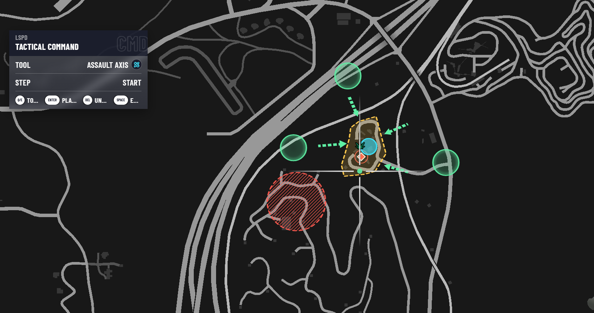
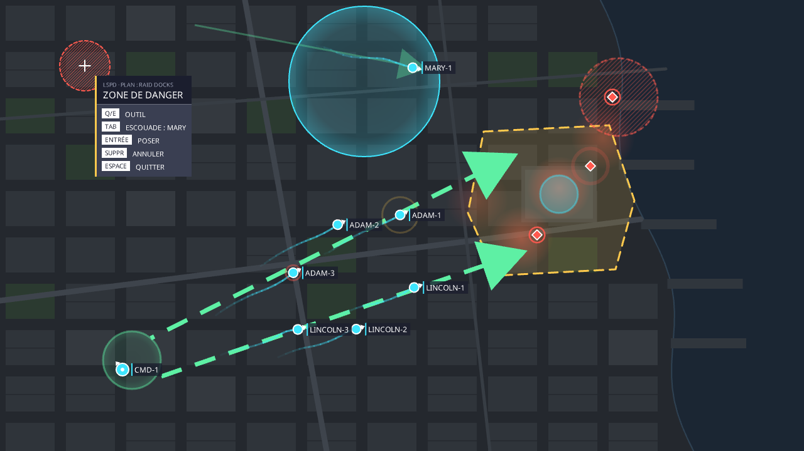

# sxCommand

Real time tactical command for **ESX, QBCore, Qbox or standalone** FiveM servers. Police, sheriff, EMS and sxIllegals groups share their positions on the minimap, their commander draws orders on the pause map, and every member can mark an enemy for the team. Everything is drawn by a custom minimap overlay (`.gfx`) written for this resource: real curves, soft gradients, hatching, dashed borders, animated arrows and units that glide with a trail.




*The overlay engine rendering a rally point, a perimeter, a hatched danger zone, an assault axis, units with trails, pings and the gunfire heat map (preview rendered outside the game).*

## Features

- **Factions**: ESX, QBCore or Qbox jobs from `Config.Factions.jobs` (police, sheriff, EMS by default, on duty only with QBCore and Qbox), sxIllegals groups when the resource is started, or the `sxcommand.police` ACE in standalone. Each faction has its color.
- **Units**: the members of a faction see each other on the minimap and the pause map. Units glide between updates with a fading trail and keep the same size at every zoom, the commander has a bigger icon, an injured member has a red pulsing halo and a member who fires flashes yellow.
- **Orders**: from the pause map, the commander places a rally point, a perimeter, an assault axis, a danger zone or an objective. The whole faction sees them live and gets a card when a new order arrives. Orders expire after `Config.Orders.duration` minutes.
- **Callsigns and squads**: every member picks a callsign (`/callsign ADAM-12`), shown next to their unit on the map and kept between sessions. The letters give the squad (`ADAM`), and the commander can give an order to a single squad: the other squads see it faded and don't get the card.
- **Operation plans**: a commander prepares a plan in private (`/tacticalplan edit raid`), draws its orders on the pause map, saves it and deploys it to the whole faction later in one command. Plans are kept on the server.
- **Intel pings**: every member marks the aimed spot (`G`) or a spot on the pause map. Pings pulse and fade out after `Config.Pings.life` seconds.
- **Gunfire heat map**: shots fired by players build a heat map that cools down over time.
- **Commander tools**: a command mode on the pause map with a live preview of the shape under the cursor, a perimeter that closes when clicking near its first point and undo.
- **Overlay engine**: the engine of the `.gfx` can be used by other resources through the `Atlas` client export.
- **sxHelpMenu** (optional): order cards and the command mode card, which stays visible in the pause menu (sxHelpMenu 1.4.0 or newer).
- **Without sxHelpMenu**: the command mode help (tool, squad, plan and keys) is drawn by the overlay next to the pause map cursor, and the order cards fall back to notifications.
- **Translations**: English and French.

## Dependencies

| Resource | Purpose |
| --- | --- |
| [es_extended](https://github.com/esx-framework/esx_core) | Optional. Jobs, grades and names |
| [qb-core](https://github.com/qbcore-framework/qb-core) or [qbx_core](https://github.com/Qbox-project/qbx_core) | Optional. Jobs, grades, duty and names |
| [sxIllegals](https://github.com/0xS4cha/sxIllegals) | Optional. Groups as factions, the leader and the `canCommand` permission give the commander role |
| [sxHelpMenu](https://github.com/0xS4cha/sxHelpMenu) | Optional. Order and command mode cards |

The server should run OneSync, the units are read from the server side player positions.

## Installation

1. Clone the repository into your `resources` folder.
2. Add the resource to your `server.cfg` after its optional dependencies.

   ```cfg
   ensure sxHelpMenu
   ensure sxIllegals
   ensure sxCommand
   ```

   In standalone, give the police faction and the commander role with ACE permissions:

   ```cfg
   add_ace group.police sxcommand.police allow
   add_ace group.police_chief sxcommand.commander allow
   ```

## Usage

| Key / command | Description |
| --- | --- |
| `G` | Marks the aimed spot for your faction |
| `/tactical` | Shows or hides the tactical display |
| `/tacticalscale <value>` | Changes the size of the lines and icons on the pause map live, to find the right `pauseScale`. The value is saved on the player's computer, `/tacticalscale reset` goes back to the config |
| `/callsign <callsign>` | Sets your callsign (`ADAM-12`), `clear` removes it. Commanders: `/callsign <id> <callsign>` for a member |
| `/tacticalplan <action>` | Commanders: `list`, `edit <name>`, `save [name]`, `cancel`, `load <name>`, `delete <name>` |
| `Space` in the pause map | Enters or leaves the command mode |
| `Q` / `E` | Previous / next tool (commanders) |
| `Tab` | Squad that receives the next order (commanders) |
| `Enter` | Places the order or the point under the cursor |
| `Delete` | Removes the last point, or the last order |

### Operation plans

1. `/tacticalplan edit raid`: the orders you place now only appear on your map, the card shows the plan name.
2. Draw the orders on the pause map as usual, with a squad for each if needed.
3. `/tacticalplan save`: the plan is saved and your map shows the live orders again. `cancel` leaves without saving.
4. `/tacticalplan load raid`: the plan replaces the live orders of the faction and every member gets a card.

`/tacticalplan save <name>` outside the editing mode saves the live orders as a plan. Editing an existing plan loads its orders first.

The pause map keys are frontend controls (`Config.Command`), the ping key can be changed in *Settings > Key Bindings > FiveM*. A member who is not a commander only has the mark tool in the command mode.

## Configuration

All values live in `shared/config.lua`.

| Key | Description |
| --- | --- |
| `Config.Factions.jobs` | ESX jobs that form a faction, with a `label`, a `color` (hex) and the `commandGrade` |
| `Config.Factions.ace` | ACE permissions for the standalone police faction and its commanders |
| `Config.Factions.sxIllegalsGroups` | Makes every sxIllegals group a faction |
| `Config.Factions.requireDuty` | With QBCore and Qbox, only players on duty are part of their job faction |
| `Config.Factions.refresh` | Seconds between two checks of the jobs and groups |
| `Config.Units.interval` | Milliseconds between two position updates |
| `Config.Units.injuredHealth` / `firingSeconds` | When a unit shows as injured, how long the firing flash lasts |
| `Config.Squads` | Callsign command, maximum length and the labels on the map |
| `Config.Plans` | Plan command, plans per faction and name length |
| `Config.Orders.duration` / `maxPerFaction` / `maxPoints` | Lifetime and limits of the orders |
| `Config.Orders.radius` | Radius of the rally point, danger zone and objective |
| `Config.Pings` | Lifetime, cooldown, aim distance and key of the marks |
| `Config.Heat` | Cell size, heat per shot, cooling and update interval of the heat map |
| `Config.Command` | Frontend controls of the command mode (`target` cycles the squads) and the distance that closes a perimeter |
| `Config.Display.command` | Command that toggles the display |
| `Config.Display.pauseScale` | How much larger the game draws the overlay on the pause map than on the minimap, lines and icons are divided by it there. A value set with the calibration command replaces it for that player |
| `Config.Display.mapHint` | Draws the command mode help next to the pause map cursor when sxHelpMenu is not running |
| `Config.Display.scaleCommand` | Command that changes `pauseScale` live to calibrate it, the value is printed in the F8 console |

## How it works

`core/SX_COMMAND.gfx` is the minimap overlay of the game with an extra ActionScript 2 engine (`gfx/src/sx_engine.as`) that keeps layers of shapes, markers, pings and a heat map and animates them every frame. The Lua side sends compact commands (`SX_SHAPE_CIRCLE`, `SX_MARKER`…) and the engine interpolates between updates, so a unit update is one call per second.

The server resolves the faction of every player, sends each faction the positions of its members every second, keeps the orders and the pings, and cools down the heat map. Only the members of a faction receive its data. Callsigns (per character) and plans (per faction) are stored in the resource KVP of the server, nothing needs a database.

FiveM has no native to remove a minimap overlay, so the resource clears everything it drew when it stops.

### Rebuilding the overlay

The overlay is built from `gfx/base/MINIMAP_LOADER.gfx` and `gfx/src/sx_engine.as` with [JPEXS FFDec](https://github.com/jindrapetrik/jpexs-decompiler):

```bash
FFDEC=/path/to/ffdec-cli.jar ./gfx/build.sh
```

On Windows, with Java 8 or newer in the `PATH`:

```powershell
.\gfx\build.ps1 -FFDec C:\path\to\ffdec-cli.jar
```

If PowerShell refuses to run the script, allow it for the current session with `Set-ExecutionPolicy -Scope Process Bypass`.

Only the `MINIMAP_LOADER` class is recompiled, under the name `SX_COMMAND_LOADER`, the other classes of the file stay untouched. ActionScript classes are shared by every minimap overlay, so the engine needs its own class name to work next to resources that load the stock overlay, such as sxIllegals or sxHeat.

## Exports

### Server

| Export | Description |
| --- | --- |
| `GetFaction(source)` | Faction of a player (`id`, `label`, `color`, `commander`) or `nil` |
| `GetOrders(factionId)` | Active orders of a faction |
| `CreateOrder(source, kind, points, squad?)` | Places an order as this player, `kind` is `rally`, `perimeter`, `axis`, `danger` or `objective`, `squad` limits it to one squad |
| `GetCallsign(source)` / `SetCallsign(source, callsign)` | Callsign of a player, `nil` removes it |
| `GetPlans(factionId)` | Saved plans of a faction (`name`, `orders`, `author`, `savedAt`) |
| `DeployPlan(factionId, name, source?)` | Deploys a saved plan, returns the number of orders or `nil` |
| `Ping(source, coords)` | Marks a spot for the faction of the player |
| `AddShot(coords)` | Adds a shot to the heat map |

### Client

| Export | Description |
| --- | --- |
| `GetFaction()` / `IsCommander()` | Faction of the local player |
| `GetCallsign()` | Callsign of the local player |
| `Ping(coords)` | Marks a spot for the local faction |
| `Atlas()` | Drawing functions of the overlay (`circle`, `polygon`, `arrow`, `remove`, `clearLayer`) |

### Server events

| Event | Arguments |
| --- | --- |
| `sxCommand:orderCreated` | `factionId`, `kind`, `points`, `source`, `squad` |
| `sxCommand:callsignChanged` | `source`, `callsign` |
| `sxCommand:planDeployed` | `factionId`, `name`, `source` |
| `sxCommand:pinged` | `factionId`, `ping`, `source` |

## License

MIT
