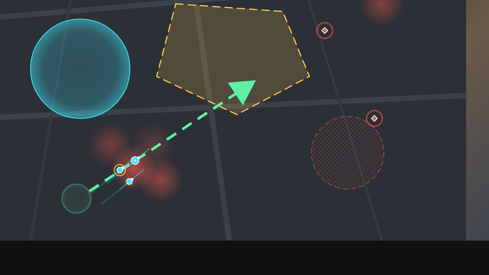

# sxCommand

Real time tactical command for **ESX or standalone** FiveM servers. Police, sheriff, EMS and sxIllegals groups share their positions on the minimap, their commander draws orders on the pause map, and every member can mark an enemy for the team. Everything is drawn by a custom minimap overlay (`.gfx`) written for this resource: real curves, soft gradients, hatching, dashed borders, animated arrows and units that glide with a trail.



*The overlay engine rendering a rally point, a perimeter, a hatched danger zone, an assault axis, units with trails, pings and the gunfire heat map (preview rendered outside the game).*

## Features

- **Factions**: ESX jobs from `Config.Factions.jobs` (police, sheriff, EMS by default), sxIllegals groups when the resource is started, or the `sxcommand.police` ACE in standalone. Each faction has its color.
- **Units**: the members of a faction see each other on the minimap and the pause map. Units glide between updates with a fading trail and keep the same size at every zoom, the commander has a bigger icon, an injured member has a red pulsing halo and a member who fires flashes yellow.
- **Orders**: from the pause map, the commander places a rally point, a perimeter, an assault axis, a danger zone or an objective. The whole faction sees them live and gets a card when a new order arrives. Orders expire after `Config.Orders.duration` minutes.
- **Intel pings**: every member marks the aimed spot (`G`) or a spot on the pause map. Pings pulse and fade out after `Config.Pings.life` seconds.
- **Gunfire heat map**: shots fired by players build a heat map that cools down over time.
- **Commander tools**: a command mode on the pause map with a live preview of the shape under the cursor, a perimeter that closes when clicking near its first point and undo.
- **Overlay engine**: the engine of the `.gfx` can be used by other resources through the `Atlas` client export.
- **sxHelpMenu** (optional): order cards and the command mode card, which stays visible in the pause menu (sxHelpMenu 1.4.0 or newer).
- **Translations**: English and French.

## Dependencies

| Resource | Purpose |
| --- | --- |
| [es_extended](https://github.com/esx-framework/esx_core) | Optional. Jobs, grades and names |
| [sxIllegals](https://github.com/0xS4cha/sxIllegals) | Optional. Groups as factions, the leader and the `canCommand` permission give the commander role |
| [sxHelpMenu](https://github.com/0xS4cha/sxHelpMenu) | Optional. Order and command mode cards |

The server should run OneSync, the units are read from the server side player positions.

## Installation

1. Clone the repository into your `resources` folder.
2. Add the resource to your `server.cfg` after its optional dependencies.

   ```cfg
   ensure sxHelpMenu
   ensure sxIllegals
   ensure sxCommand
   ```

   In standalone, give the police faction and the commander role with ACE permissions:

   ```cfg
   add_ace group.police sxcommand.police allow
   add_ace group.police_chief sxcommand.commander allow
   ```

## Usage

| Key / command | Description |
| --- | --- |
| `G` | Marks the aimed spot for your faction |
| `/tactical` | Shows or hides the tactical display |
| `Space` in the pause map | Enters or leaves the command mode |
| `Q` / `E` | Previous / next tool (commanders) |
| `Enter` | Places the order or the point under the cursor |
| `Delete` | Removes the last point, or the last order |

The pause map keys are frontend controls (`Config.Command`), the ping key can be changed in *Settings > Key Bindings > FiveM*. A member who is not a commander only has the mark tool in the command mode.

## Configuration

All values live in `shared/config.lua`.

| Key | Description |
| --- | --- |
| `Config.Factions.jobs` | ESX jobs that form a faction, with a `label`, a `color` (hex) and the `commandGrade` |
| `Config.Factions.ace` | ACE permissions for the standalone police faction and its commanders |
| `Config.Factions.sxIllegalsGroups` | Makes every sxIllegals group a faction |
| `Config.Factions.refresh` | Seconds between two checks of the jobs and groups |
| `Config.Units.interval` | Milliseconds between two position updates |
| `Config.Units.injuredHealth` / `firingSeconds` | When a unit shows as injured, how long the firing flash lasts |
| `Config.Orders.duration` / `maxPerFaction` / `maxPoints` | Lifetime and limits of the orders |
| `Config.Orders.radius` | Radius of the rally point, danger zone and objective |
| `Config.Pings` | Lifetime, cooldown, aim distance and key of the marks |
| `Config.Heat` | Cell size, heat per shot, cooling and update interval of the heat map |
| `Config.Command` | Frontend controls of the command mode and the distance that closes a perimeter |
| `Config.Display.command` | Command that toggles the display |

## How it works

`core/SX_COMMAND.gfx` is the minimap overlay of the game with an extra ActionScript 2 engine (`gfx/src/sx_engine.as`) that keeps layers of shapes, markers, pings and a heat map and animates them every frame. The Lua side sends compact commands (`SX_SHAPE_CIRCLE`, `SX_MARKER`…) and the engine interpolates between updates, so a unit update is one call per second.

The server resolves the faction of every player, sends each faction the positions of its members every second, keeps the orders and the pings, and cools down the heat map. Only the members of a faction receive its data.

FiveM has no native to remove a minimap overlay, so the resource clears everything it drew when it stops.

### Rebuilding the overlay

The overlay is built from `gfx/base/MINIMAP_LOADER.gfx` and `gfx/src/sx_engine.as` with [JPEXS FFDec](https://github.com/jindrapetrik/jpexs-decompiler):

```bash
FFDEC=/path/to/ffdec-cli.jar ./gfx/build.sh
```

Only the `MINIMAP_LOADER` class is recompiled, the other classes of the file stay untouched.

## Exports

### Server

| Export | Description |
| --- | --- |
| `GetFaction(source)` | Faction of a player (`id`, `label`, `color`, `commander`) or `nil` |
| `GetOrders(factionId)` | Active orders of a faction |
| `CreateOrder(source, kind, points)` | Places an order as this player, `kind` is `rally`, `perimeter`, `axis`, `danger` or `objective` |
| `Ping(source, coords)` | Marks a spot for the faction of the player |
| `AddShot(coords)` | Adds a shot to the heat map |

### Client

| Export | Description |
| --- | --- |
| `GetFaction()` / `IsCommander()` | Faction of the local player |
| `Ping(coords)` | Marks a spot for the local faction |
| `Atlas()` | Drawing functions of the overlay (`circle`, `polygon`, `arrow`, `remove`, `clearLayer`) |

### Server events

| Event | Arguments |
| --- | --- |
| `sxCommand:orderCreated` | `factionId`, `kind`, `points`, `source` |
| `sxCommand:pinged` | `factionId`, `ping`, `source` |

## License

MIT
